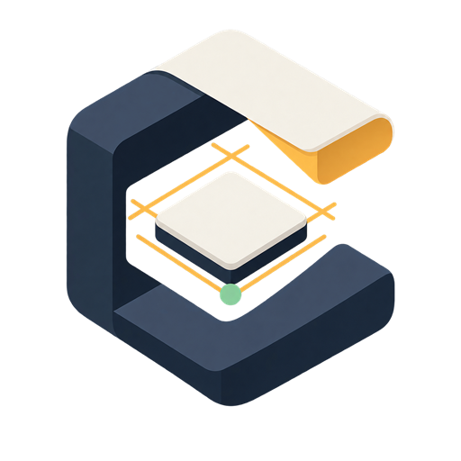
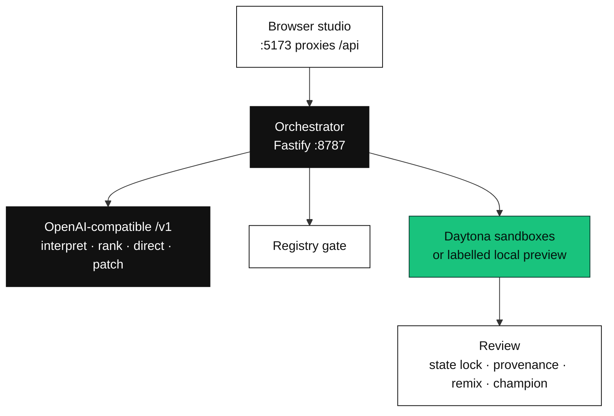
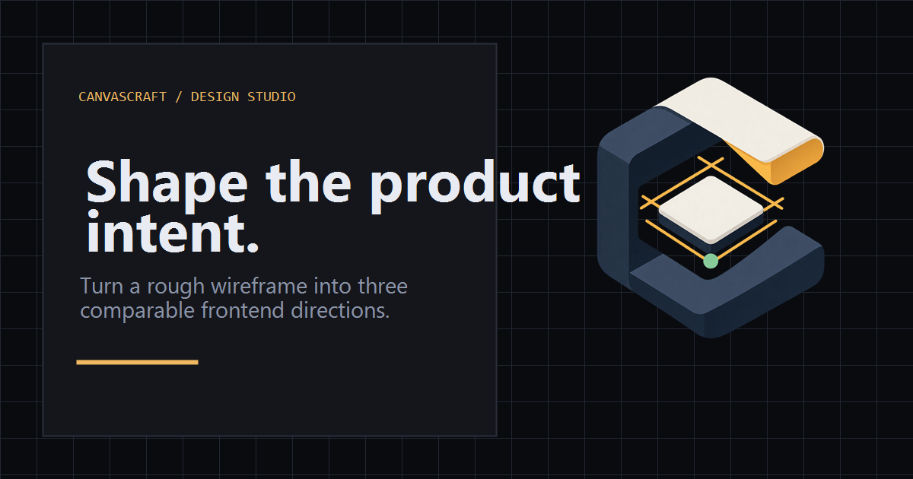
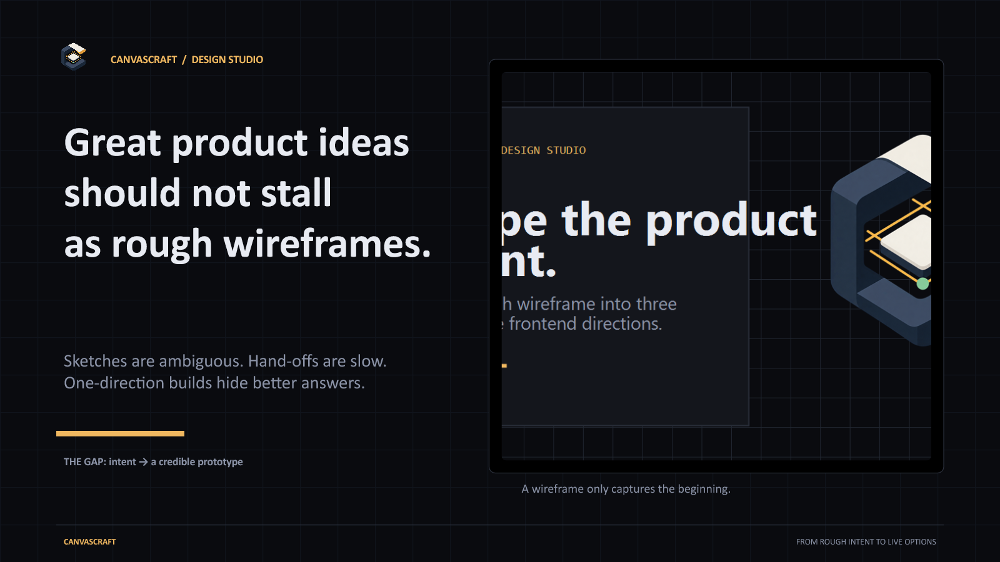
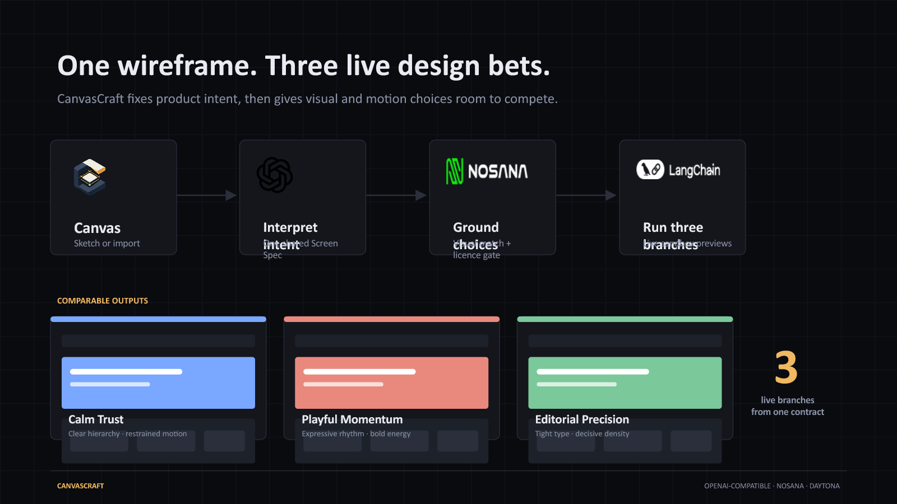
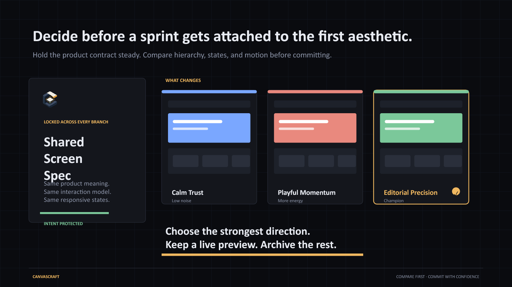
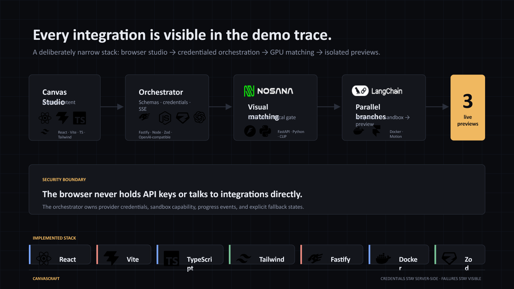

<p align="center">
  
</p>

<p align="center">
  <strong>🏆 2nd place · Daytona HackSprint Singapore</strong>
</p>

<p align="center">
  <strong>Turn a rough wireframe into three live frontend directions that share one product contract.</strong><br>
  <sub>One validated Screen Spec. Three Variant Manifests. Daytona sandboxes when configured. A labelled local compiler when not.</sub>
</p>

<p align="center">
  <a href="https://www.typescriptlang.org/"></a>
  <a href="https://react.dev/"></a>
  <a href="https://vite.dev/"></a>
  <a href="https://tailwindcss.com/"></a>
  <a href="https://fastify.dev/"></a>
  <a href="https://zod.dev/"></a>
  <a href="https://pnpm.io/"></a>
  <a href="https://vitest.dev/"></a>
  <a href="https://www.daytona.io/"></a>
  <a href="https://platform.openai.com/docs/api-reference"></a>
</p>

---

## ▍The problem

A wireframe says what is on the screen. It does not say hierarchy, local states, motion, or how the same product should feel in a second visual system. Teams either spend days prototyping that gap, or accept one generated UI they cannot compare.

CanvasCraft keeps the product fixed and lets the treatment vary. The canvas becomes one Screen Spec. That spec is hashed into three Variant Manifests. A reviewer compares three branches of the same contract, then keeps a champion.

## ▍The pipeline

```mermaid
flowchart LR
    classDef input fill:#0b0f0e,stroke:#19c37d,color:#e8f3ec,stroke-width:1.5px
    classDef stage fill:#ffffff,stroke:#111,color:#111,stroke-width:1px
    classDef model fill:#111,stroke:#111,color:#fff,stroke-width:1px
    classDef output fill:#19c37d,stroke:#0b3d31,color:#04120d,stroke-width:1.5px

    C[("CanvasDoc<br/>stamps · ink · notes · arrows")]:::input
    C --> P["Pre-pass<br/>compileScreenSpec<br/>always"]:::stage
    P --> I{"OPENAI_API_KEY"}:::input
    I -->|"set"| V["Enrich the spec from JSON<br/>text model while no PNG is posted<br/>one repair, else keep pre-pass"]:::model
    I -->|"absent"| G["buildCandidates<br/>licence gate first<br/>18 records"]:::stage
    V --> G
    G --> R{"rank"}:::input
    R -->|"key + complete JSON"| O["gpt-5.6-luna default<br/>matchSource: openai"]:::model
    R -->|"no key or failure"| L["Keep registry order<br/>matchSource: local"]:::stage
    O --> M["buildDirections<br/>always three"]:::stage
    L --> M
    M --> AI{"propose"}:::input
    AI -->|"key + valid"| Q["Replace with model manifests<br/>one repair"]:::model
    AI -->|"no key or failure"| A["Layout audit"]:::stage
    Q --> A
    A --> B["Two generated modules"]:::stage
    B --> S{"DAYTONA_API_KEY<br/>+ snapshot"}:::input
    S -->|"set"| Y["Three sandboxes<br/>port 4173"]:::output
    S -->|"unset or failed"| F["Labelled local preview"]:::stage
    Y --> REV["Design review<br/>measured, plus model<br/>recommendations if keyed"]:::stage
    F --> REV
```



| Stage | Who decides | What is locked |
| --- | --- | --- |
| **Canvas** | The person in the studio | Stamps (navbar, hero, card, button, input, table, tabs, media, modal, sidebar), an optional image base, ink and erase strokes, notes, labelled arrows, pan/zoom, selection. `Ctrl+Z` / `Ctrl+Shift+Z` undo and redo. `Delete` removes the selection. Four starter templates, one per archetype. The board opens empty. PNG export exists on the studio. The generate call in `App.tsx` posts `canvasImage: null`. |
| **Screen Spec** | Pre-pass always. A keyed model enriches that spec | Regions, roles, interactions, local states, accessibility baseline, responsive behaviour. One object per run. With no posted image the call uses `OPENAI_TEXT_MODEL` (default `gpt-5.6-luna`). A `data:image/` payload uses `OPENAI_VISION_MODEL` (default `gpt-5.6`). Invalid JSON gets one repair, then the pre-pass spec is kept. Every manifest stores the spec's SHA-256. A mismatch is refused. |
| **Registry gate** | `buildCandidates`, before the ranker | 18 metadata records in `packages/registry/src/catalogue.ts`. Licence, compatibility, and `allowedForPreview` are checked first. The model can reorder approved ids. It cannot add one. `allowedForExport` is `false` on every record. The trace records those decisions as the `licence-gate` stage after ranking returns. |
| **Visual rank** | `OPENAI_VISUAL_RANKER_MODEL`, batches of up to eight regions | The orchestrator draws low-detail comparison sheets from stamp bounds and registry thumbnails. It does not send the studio's ink or a photo unless a canvas image was posted, and the current client does not post one. No key, or a partial, unknown, or failed response, keeps the local order and is labelled `matchSource: "local"`. A validated ranking is `matchSource: "openai"`. |
| **Three manifests** | `buildDirections` always. The model replaces them when a key is set and validation passes | Tokens, pattern choice per region, density, surface, motion. Archetype, fonts, button shape, and motion *preset* (`calm` · `playful` · `editorial`) stay shared. Motion *language* (`reveal` · `cascade` · `spring` · `parallax` · `cut`) is what the three directions differ on. `motionIntensity: "none"` forces `cut` on all three. |
| **Layout audit** | `findLayoutRiskIssues`, then up to two AI revise rounds when a key is set and a direction has defects | Flags known-bad manifest choices (neutral fallback when a richer record was approved, `roomy` density on an app or ai-native surface, glass on a flat backdrop, a flat backdrop on a marketing page, six or more top-level sections at `roomy` density). A revision that fails integrity is discarded. Also checks `measureBranch` accessibility floors. This pass does not measure pixels in a browser. |
| **Branch** | The materialiser | Writes only `src/generated/screen-spec.ts` and `src/generated/variant-manifest.ts` into `packages/branch-template`. The template renders them. Generated text is rejected if it contains `fetch`, `XMLHttpRequest`, `WebSocket`, `axios`, `process.env`, `express`, `prisma`, or `supabase`. |
| **Preview** | Daytona, or the in-browser preview | Three sandboxes from `infra/daytona-snapshot/Dockerfile` (`node:22`, port 4173) when `DAYTONA_API_KEY` and `DAYTONA_SNAPSHOT` are set. Otherwise the studio shows a manifest-driven preview and says so. |

Archetypes are chosen once, in the toolbar, and shared by all three directions: `marketing`, `application`, `portfolio`, `ai-native`. Comparison happens inside an archetype. Deterministic personalities are named **Composed Depth**, **Kinetic Signal**, and **Editorial Precision**. A live model may name its own pair of title-case words. ADR 0002 and one stage-detail string in `apps/orchestrator/src/app.ts` still mention the older example names Calm Trust, Playful Momentum, and Editorial Precision. After the sandboxes (or the local preview), a `design-review` stage writes measured accessibility recommendations and, with a key, model recommendations. One repair, then the measured set.

The browser talks only to the orchestrator. OpenAI-compatible and Daytona credentials stay in the orchestrator process. Review can lock a fixture state across branches, switch desktop and mobile widths, inspect per-region provenance, apply or revert a Design Director recommendation, patch one region, remix traits into another branch, and select a champion. Non-champion sandboxes can be stopped. Drafts and runs are remembered in `localStorage` in this browser. There are no accounts.



## ▍Project gallery

<table><tr>
<td width="50%"></td>
<td width="50%"></td>
</tr></table>

<sub>Images from the [project portfolio](https://bede-lau.github.io/); they may depict an earlier build.</sub>


## ▍The demo

There is no captured screenshot of the running studio in this repository. `pnpm dev` is the demo. What is committed:

<p align="center">
  
</p>

<p align="center"><sub>Social card in <code>apps/web/public/brand/</code>. Same claim as the package description. It is not a screenshot of the app.</sub></p>

The folder `CanvasCraft_2min_demo/` holds four pitch slides.

<table>
  <tr>
    <td width="50%" valign="top">
      
      <br><sub><strong>01 · Problem.</strong> Pitch slide. Not the studio.</sub>
    </td>
    <td width="50%" valign="top">
      
      <br><sub><strong>02 · Retired diagram.</strong> Names Nosana. That matcher is not in <code>apps/</code> or <code>packages/</code>. Ranking is the OpenAI-compatible vision path in ADR 0004.</sub>
    </td>
  </tr>
  <tr>
    <td width="50%" valign="top">
      
      <br><sub><strong>03 · Comparison, as pitched.</strong> The shared-spec idea is the product. The three titles on the slide are the PRD's examples, not the deterministic names in <code>compiler.ts</code>.</sub>
    </td>
    <td width="50%" valign="top">
      
      <br><sub><strong>04 · Retired diagram.</strong> Names Nosana and LangChain. The code path is browser → orchestrator → OpenAI-compatible calls → Daytona.</sub>
    </td>
  </tr>
</table>

Two offline paths. With the orchestrator up and no key, the run is `compileScreenSpec` and `buildDirections`, and the trace is that service's events. If `createRun` throws, the studio ignores the canvas on screen and plays `RUN_STAGES` from `apps/web/src/lib/demo.ts` on a 520ms timer, with the fixture manifests Composed Depth, Kinetic Signal, and Editorial Precision. Those lines say "fixture", "local", and "in-browser simulation". They are a script, not a model trace.

## ▍Run it

Node `>=22` (`package.json` `engines`) and pnpm `10.29.3` (`packageManager`). `pnpm doctor` exits on Node major below 20 — its message says 20.19 or newer — and checks that the workspace files are present. Use 22.

```sh
pnpm install
pnpm dev
```

`pnpm dev` starts the web app and the orchestrator together. Either process alone:

```sh
pnpm dev:web
pnpm dev:orchestrator
```

| URL | What |
| --- | --- |
| `http://127.0.0.1:5173` | Vite studio. Proxies `/api` to the orchestrator. Override the target with `VITE_ORCHESTRATOR_PROXY` (default `http://127.0.0.1:8787`). |
| `http://127.0.0.1:8787` | Fastify orchestrator. `HOST` defaults to `127.0.0.1`, `PORT` to `8787`. |

**No key is required.** With an empty environment the compiler, the registry, and the in-browser preview run, and the trace says they are local. Copy `.env.example` to `.env` at the repo root only when you want live calls. The browser never receives these values. Do not commit `.env`.

| Variable | Default when unset | Used for |
| --- | --- | --- |
| `OPENAI_API_KEY` | absent → offline compiler | Live interpretation, ranking, direction, director, and patch calls |
| `OPENAI_BASE_URL` | `https://api.openai.com/v1` | Any OpenAI-compatible `/v1` endpoint |
| `OPENAI_VISION_MODEL` | `gpt-5.6` | Interpretation only when the request includes a `data:image/` canvas. The studio currently sends `null` |
| `OPENAI_VISUAL_RANKER_MODEL` | `gpt-5.6-luna` | Reranks approved registry candidates from server-drawn sheets |
| `OPENAI_TEXT_MODEL` | `gpt-5.6-luna` | Interpretation without an image, plus directions, recommendations, and patch instructions |
| `DAYTONA_API_KEY` | absent → no sandboxes | Live branch sandboxes. Also requires `DAYTONA_SNAPSHOT` |
| `DAYTONA_API_URL` | `https://app.daytona.io/api` | Daytona API |
| `DAYTONA_TARGET` | `us` | Daytona target |
| `DAYTONA_SNAPSHOT` | none | Registered snapshot name or id. The sample in `.env.example` is `canvascraft-vite-starter:0.1.0` |
| `DAYTONA_PREVIEW_PORT` | `4173` | Port each sandbox serves |
| `DAYTONA_AUTO_STOP_MINUTES` | `30` (`0` never stops) | Inactivity stop |
| `WEB_ORIGIN` | `http://localhost:5173` | Extra CORS origin. `http://localhost:5173` and `http://127.0.0.1:5173` are always allowed |
| `DATA_DIR` | `./.canvascraft` | Run artifacts. Gitignored |
| `LOG_LEVEL` | `info` | Orchestrator log level |

`pnpm snapshot:build` runs `scripts/build-daytona-snapshot.mjs`. It needs Docker. It tags `canvascraft-vite-starter:` plus the first 12 hex characters of the branch-template `package.json` hash, unless `DAYTONA_SNAPSHOT_IMAGE` is set. Register that tag as a Daytona snapshot, then put the id in `DAYTONA_SNAPSHOT`.

### Verify

```sh
pnpm doctor
pnpm typecheck
pnpm lint          # alias of typecheck
pnpm test          # vitest across the workspace, including branch-qa
pnpm registry:validate
pnpm build
```

`packages/branch-template` is outside the pnpm workspace on purpose. It is copied into sandboxes and installs from the snapshot, not from the host `node_modules`. `packages/branch-qa` renders that template under jsdom.

## ▍Repository map

```
canvascraft/
├── apps/
│   ├── web/                     React + Vite studio, react-konva canvas
│   └── orchestrator/            Fastify. Credentials, compiler, Daytona client
├── packages/
│   ├── schema/                  Zod contracts and JSON Schema
│   ├── registry/                18 reviewed records, licence gate, thumbnails
│   ├── branch-qa/               jsdom render audit. Not shipped in the snapshot
│   └── branch-template/         Vite starter copied into a sandbox. Not a workspace package
├── infra/daytona-snapshot/      Dockerfile (node:22, preview port 4173)
├── scripts/                     doctor.mjs, build-daytona-snapshot.mjs
├── docs/                        architecture, checkpoint, adr/
├── CanvasCraft_PRD.md
├── DESIGN.md
└── CanvasCraft_2min_demo/       four pitch slides
```

| Doc | |
| --- | --- |
| [CanvasCraft_PRD.md](CanvasCraft_PRD.md) | Product scope, journey, and explicit non-goals |
| [docs/architecture.md](docs/architecture.md) | Trust boundaries and the generation pipeline |
| [DESIGN.md](DESIGN.md) | Shell rules versus branch rules, archetypes, motion, reduced motion |
| [docs/checkpoint.md](docs/checkpoint.md) | Progress record. Last updated 2026-08-30. Later ADRs are ahead of it |
| [docs/adr/](docs/adr) | 0001 monorepo boundaries through 0010 pattern adapters |

There is no repository `LICENSE` file. Pattern licences live on the registry records: React Bits is MIT plus Commons Clause and is preview-only; Beautiful UI, the coss ui MIT `apps/ui` records, and the free ReUI records are MIT. CanvasCraft-original records are marked `canvascraft-original`. Third-party source is not vendored. Adapters in `packages/branch-template/src/patterns/` are written in this repo.

## ▍What this is, and isn't

We'd rather be precise than impressive.

- The studio runs offline. A local match, a simulated preview, and a stored manifest are labelled local. They are not a model ranking and they are not a Daytona sandbox.
- `docs/checkpoint.md` (2026-08-30) records a credentialed OpenAI interpretation as done, credentialed visual ranking as not exercised, and a credentialed Daytona launch as blocked on a registered snapshot. `DESIGN.md` still lists the credentialed Daytona lifecycle as an open question. The client code for both adapters is in the orchestrator.
- Layout audit is a static check plus an optional model revise. ADR 0009 says real-browser geometry (overlap, overflow) is not in the request path. That Playwright pass is described as future work. `branch-qa` is jsdom.
- `reui-app-frame` and `reui-stepper` have no pattern component. `resolvePattern` falls through to the role's neutral component. ADR 0010 leaves them there. The two `canvascraft-neutral-*` records resolve the same way, which is the intended fallback.
- Generated branches are one frontend screen with local fixtures. They do not get a backend, auth, a database, payments, or network calls. There is no source-export of third-party components.
- Motion is template code (Motion, GSAP, Lenis) driven by manifest fields. It is not a learned animation model. Reduced motion drops movement and keeps the treatment.
- Workspaces are `localStorage`. Closing the browser profile drops them. The orchestrator's run files live under `DATA_DIR`.
- The pitch deck is not the architecture. Slides 2 and 4 name Nosana and LangChain. Commit `33680f8` replaced the Nosana GPU matcher with the OpenAI visual ranker.

## ▍Credits

| | |
| --- | --- |
| Canvas | [react-konva](https://github.com/konvajs/react-konva) / [Konva](https://konvajs.org/) |
| Studio UI | React 19, [Base UI](https://base-ui.com/), Tailwind CSS 4, [Motion](https://motion.dev/), [Lucide](https://lucide.dev/) |
| Branch motion | Motion, [GSAP](https://gsap.com/) (ScrollTrigger), [Lenis](https://github.com/darkroomengineering/lenis) |
| Contracts | [Zod](https://zod.dev/) 4, validated again on every model response |
| Orchestrator | [Fastify](https://fastify.dev/), [OpenAI SDK](https://github.com/openai/openai-node) against an OpenAI-compatible `/v1` endpoint |
| Sandboxes | [@daytona/sdk](https://www.daytona.io/) 0.207.0 (lockfile), Docker snapshot |
| Pattern metadata | [React Bits](https://reactbits.dev/components/card-swap) (MIT + Commons Clause), [Beautiful UI](https://www.beautifului.dev/) (MIT), [coss ui](https://ui.coss.com/) MIT `apps/ui`, [ReUI](https://reui.io/) free MIT records. Adapters here are original. |
| Models, when a key is set | `gpt-5.6` for vision, `gpt-5.6-luna` for ranking and text. Both are env defaults, not a claim that a particular run used them. |

<p align="center"><sub>2nd place · Daytona HackSprint Singapore. Offline without keys. Live calls only when <code>.env</code> says so.</sub></p>
